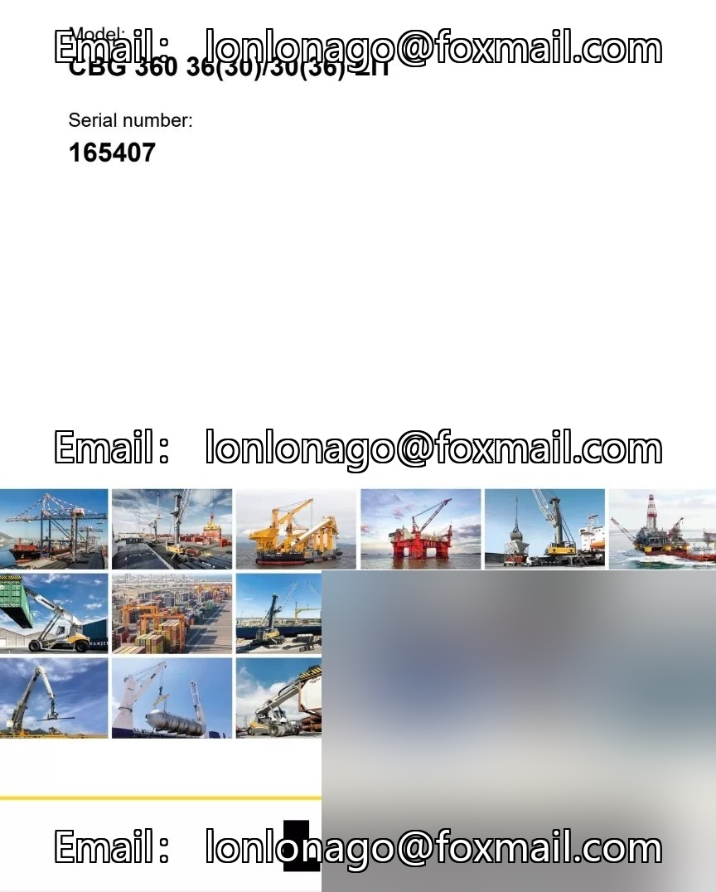
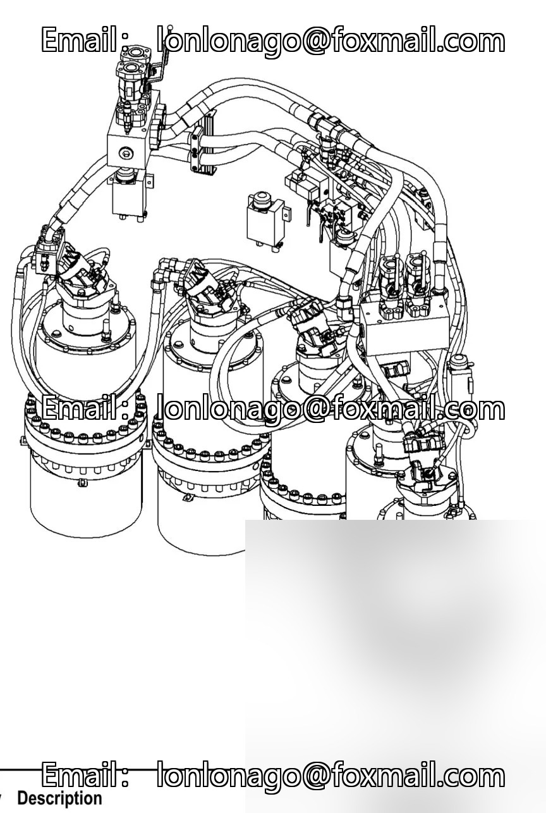
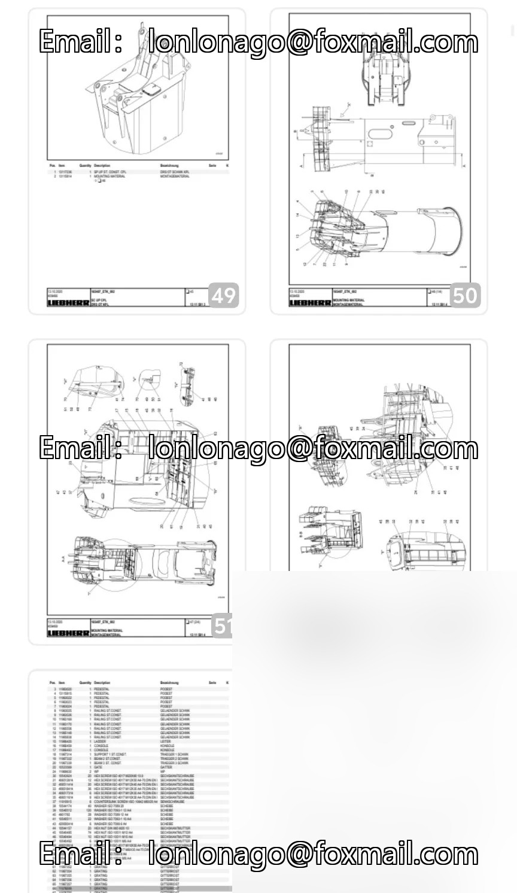
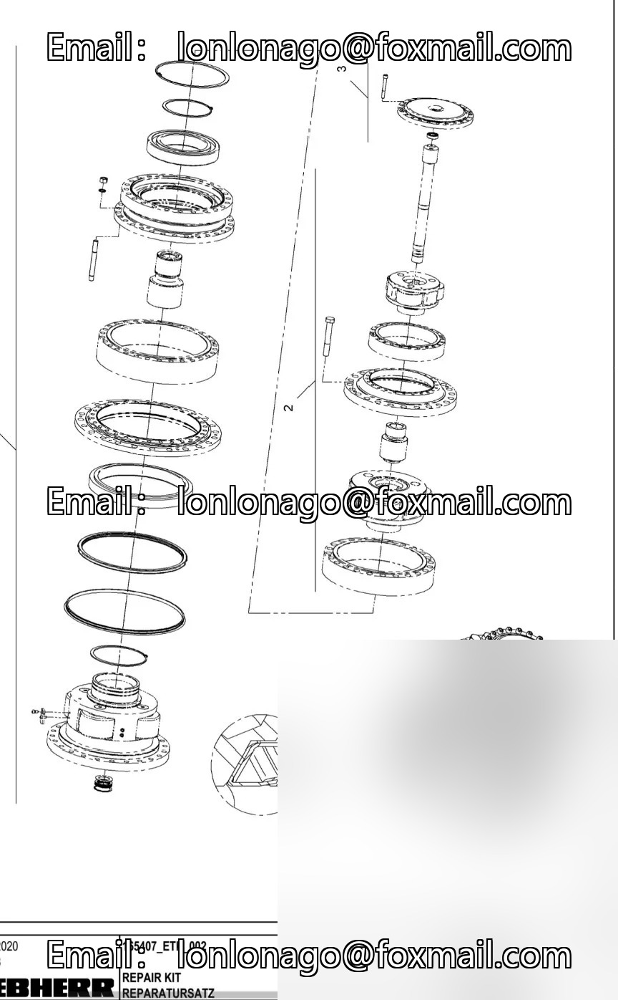
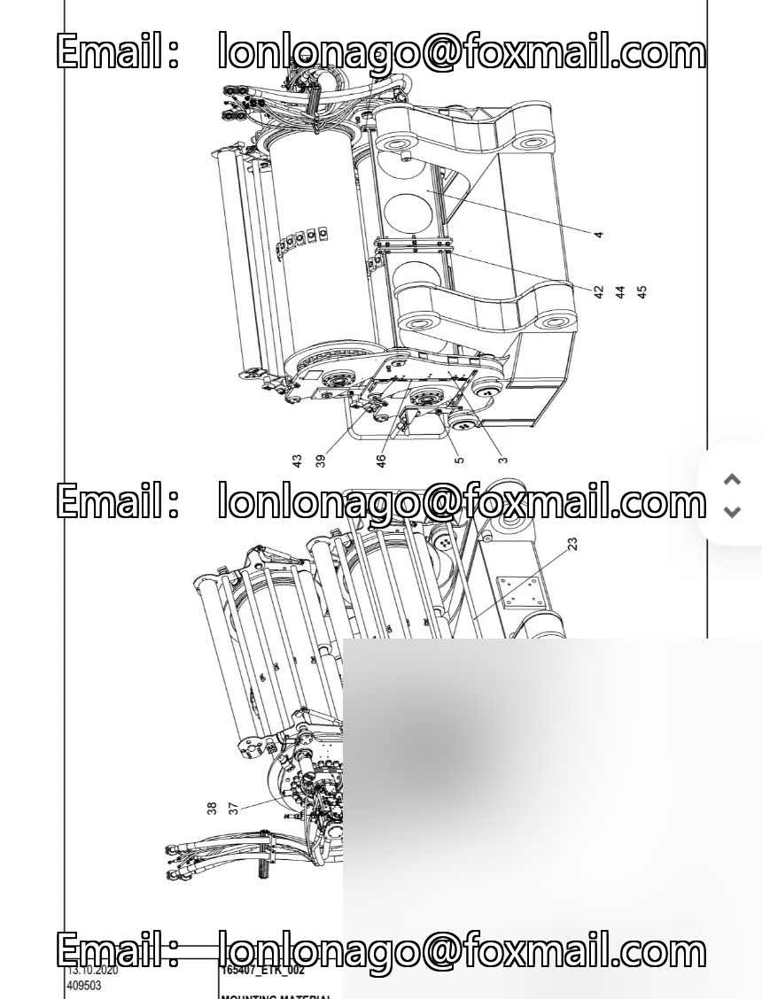
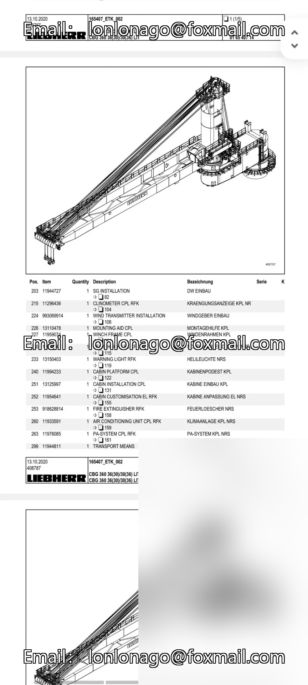

# Liebherr (LIEBHERR) CBG 360-type floating/marine four-rope

## Body

LIEBHERR (LIEBHERR) CBG 360 floating/boat-specific four-hand grab crane spare parts manual
PDF file, 660 pages
56323

Device type: CBG 360 is a high-performance floating derrick/cetwork-based four-rope grappling crane (derived from the mature CBG 350).

Primary application scenarios: designed for high-speed loading and unloading of bulk cargo (such as coal, ore, and grain) in ports, and ship-to-ship transshipment operations. It can be used for transshipment vessels in protected waterways, and can also be equipped with an eccentric platform to serve large vessels in open waters (up to Capesize, approximately 180,000 tons).

“LIT” suffix on model represents that the equipment is equipped with Livhiler's independently developed Litronic® integrated electronic control system, which can achieve automated control and precise monitoring of ship roll/pitch under various conditions, and trigger emergency procedures in critical states to guarantee operational safety and energy savings.

2. Core performance parameters (typical values)

Maximum lifting capacity: hoisting condition 50 tons; grab condition 45 tons (model 36(30)/30(36) usually refers to the combination of different working radii and rated load, such as 30 tons at a 36-meter amplitude, or 36 tons at a 30-meter amplitude).

Maximum working radius (amplitude): 36 meters (if equipped with an eccentric platform, the working radius can be extended by a maximum of 12 meters, covering a larger boat cabin).

Lift speed: empty load (≤15 tons) can reach a maximum of 130 meters per minute; full load (45/50 tons) is approximately 42~47 meters per minute, with extremely high continuous operation efficiency for bulk goods.

Rotate performance: 360° unlimited rotation, maximum rotation speed of 1.4 turns/minute.

Varying length time: approximately 55 seconds for the boom to extend from 12 meters to 36 meters.

Design conditions: maximum roll angle 5°/yaw angle 2° (or vice versa); operating wind speed 20m/s, dock resistance wind speed 63m/s; working temperature -20℃ to +45℃。

Power configuration: Double three-phase rat cage motor (2×345kW @60Hz), protection grade IP55, main power supply 440V/3-phase.

Firm level: According to the FEM 1.001 standard, the whole machine level reaches A8/Q3/U7 (level for heavy load and high frequency continuous operation).

3. Structure and design characteristics

Heavy hoisting and wire rope: using single-layer winding heavy hoisting machines, enlarged strengthened pulleys, and reinforced wire rope, which substantially extends the life of the wire rope and reduces wear.

Compact revolving column: the structure is compact, and the overturning moment on the installation seat (ship body/barge) is small; equipped with a balance optimization weight block system.

Humanized driving cabin: The extended or expanded comfortable driving cabin provides an excellent view, equipped with anti-roll and auxiliary operation systems (such as the SmartGrip® smart grab/adaptive filling technology when selected).

Maintenance convenience: add maintenance platforms to the turntable and arm frames, place core hydraulic/mechanical components inside dust-protection compartments, to adapt to harsh marine climatic conditions.

4. Intelligent selection and configuration (common configurations of the same series)

LiCAS: Collision avoidance warning system (collision avoidance when multiple cranes work in coordination).

LiDAT SmartApp: Large data analysis of equipment operations and performance, for troubleshooting bottlenecks and optimizing scheduling.

LiSIM®: A virtual operation training simulator based on the real Litronic system.

The LIEBHERR CBG 360 floating/ship-mounted four-wire grabber crane parts manual provides a PDF of 660 pages, along with type information and core performance parameters including lifting weight, working radius, lifting speed, rotation performance, aiming time, design conditions, power configuration and machine level.

<!-- AI_ENRICHED -->

## Images

## Payment

Here is a pay link on Stripe ( https://buy.stripe.com/3cs8yP7sY87d0vu9AB ). Please contact me lonlonago@foxmail.com after funding $89, and I will send you a complete data files , thank you!

